Version 0.9.8 (November 2026). ActivityTrack Desktop is the PC app of
ActivityTrack. It lives in the notification area, next to the clock, and keeps
the running activities and the *To-dos* a click away. So an activity, even a
short one, goes in from the keyboard instead of the phone.

The interface is in Italian; the screenshots show it as it is.

## 1. What it needs

- The organisation's **ActivityTrack Web** server: the PC pairs like a phone
  and syncs both ways.
- **Linux** with KDE Plasma or XFCE, on Wayland or X11, or **Windows 10 or 11**.

Without a network the PC keeps working: the changes leave when the network is
back. Reports, master data and management systems stay with the phone and the
web.

On the PC ActivityTrack is **one application** with three interfaces: this
one in the notification area, the command line (`activitytrack`, package
`activitytrack-cli`) and the full-screen terminal interface
(`activitytrack-tui`). They use the same data (`~/.local/share/activitytrack`,
on Windows `%APPDATA%\activitytrack`) and the same pairing: what is done with
one shows at once in the others. They all depend on the library
`python3-activitytrack`.

## 2. Installing

From the releases page
(<https://gitlab.com/infraconsulting/activitytrack-desktop/-/releases>):

- **Debian 13 and 14, Ubuntu 24.04 and 26.04**: the package of one's
  distribution with the library's (from its page,
  <https://gitlab.com/infraconsulting/python3-activitytrack/-/releases>), installed with
  `sudo apt install ./python3-activitytrack_<version>-1-<distro>_all.deb ./activitytrack-desktop_<version>-1-<distro>_all.deb`.
  ActivityTrack shows in the applications menu.
- **Other Linux distributions**: Python 3.11 or newer, PyQt6, cryptography and
  keyring from the distribution's packages, and the library (`pip install`
  from its repository). Unpack
  `activitytrack-desktop-<version>.tar.gz` and, in its folder, start
  `python3 -m activitytrack_desktop`.
- **Windows**: `ActivityTrackDesktop-<version>-setup.exe`. It installs for the
  current user, without administrator rights. The program is **not signed**
  (no certificate costs): at the first run Windows SmartScreen warns; choose
  **"More info" → "Run anyway"**. To check the file, compare its SHA-256 with
  `SHA256SUMS` of the same release.

On XFCE the icon shows when the panel has the **notification area** ("Status
Tray" or "Notification Area" plugin). GNOME without the AppIndicator extension
has no notification area: ActivityTrack then stays open in a window.

## 3. Pairing with the server

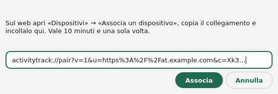

1. On the web, open **Dispositivi → "Associa un dispositivo"** (Devices →
   Pair a device; on ActivityTrack Web 0.9.3: **Telefoni → "Associa un
   telefono"**, the link under "Non riesci a inquadrarlo?").
2. Copy the **link** starting with `activitytrack://pair`.
3. At the first start ActivityTrack opens **Impostazioni → Sincronizzazione**
   (settings → sync): **"Associa a un server…"** (pair with a server, on the
   Home too) opens the pairing window. When the link is in the clipboard it
   finds it by itself. Choose **"Associa"** (pair).

The link is good for 10 minutes and once. After pairing the PC downloads the
user's data and keeps them up to date.

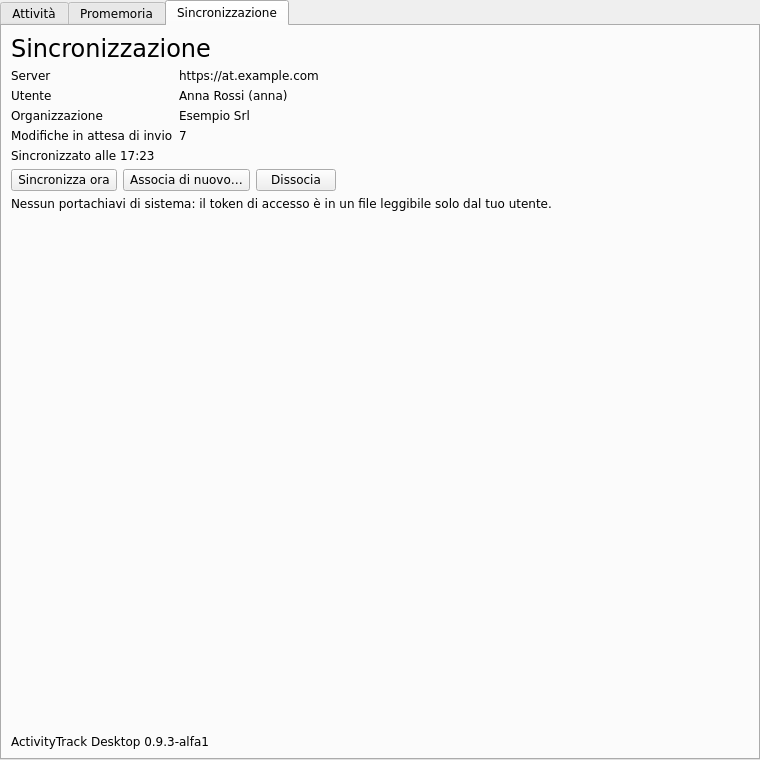

**Impostazioni → Sincronizzazione** (settings → sync) shows server, user, organisation, the
changes waiting and those the server refused (**"Non sincronizzati"**), with
**"Sincronizza ora"** (sync now), **"Associa di nuovo…"** (pair again) and
**"Dissocia"** (unpair). Unpaired, the PC keeps its data; paired with another
server or user it starts again from nothing.

The access token is kept in the system's keyring (KWallet, GNOME Keyring,
Windows Credential Manager). Without one it is in a file only one's own user
reads, and the page says so.

## 4. The icon and the menu

The icon takes the colour of the running activity: **green** at work,
**yellow** on pause, **blue** travelling, grey when nothing runs. A **red dot**
says the sync has a problem (not paired, pairing revoked, incompatible
versions).

- **Hovering**: the running activities with the time so far.
- **Click**: opens or closes the window.
- **Middle click**: pauses or resumes the activity at work.
- **Menu** (right click): each running activity's commands (Pausa, Viaggio,
  Sospendi, Stop, Modifica… — pause, travel, suspend, stop, edit);
  **"Nuova attività…"** (new activity); **"Avvia Da fare ▸"** (start a to-do)
  with the overdue and today's ones; **"Nuovo Da fare…"** (new to-do); the
  sync state; **"Esci"** (quit).

Closing the window only hides it: ActivityTrack stays in the notification area
until **"Esci"**.

## 5. The window

The window looks like the app: on the left the green bar with **Home**, **Da
fare** (to-dos) and **Impostazioni** (settings) (Ctrl+1, Ctrl+2, Ctrl+3) and,
at the bottom, **Sincronizza** (sync, F5) with a red dot when the sync has a
problem. It is light or dark as the system.

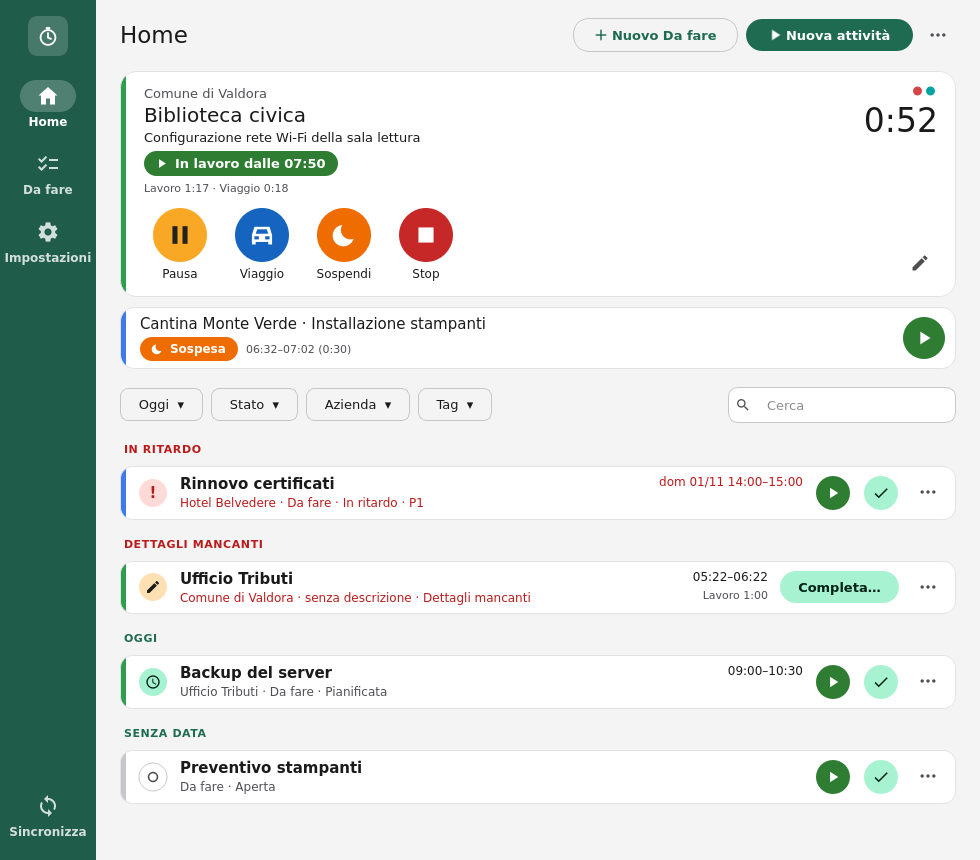

The **Home** is the phone's:

- at the top the **big card** of the latest activity: company, client and
  description, the state with its time (**"In lavoro dalle 07:46"**, working
  since), the work and travel totals, on the right the time of the running
  stretch and the tags' colours. Below, the round buttons with their names:
  **Pausa** or **Riprendi** (pause, resume), **Viaggio** (travel),
  **Sospendi** (suspend), **Stop**. A click on the card opens the activity;
- below, the **small cards** of the other activities running or suspended:
  one line with the state and the times, and the round button that resumes
  or pauses it. A click brings it to the big card;
- when nothing runs, the big card has **Avvia** (start) and **Viaggio**;
- then the filters and the list of *To-dos* and stopped activities (§7).

The coloured strip on the left of each card is the company's (or the
client's) colour chosen on the web or on the phone.

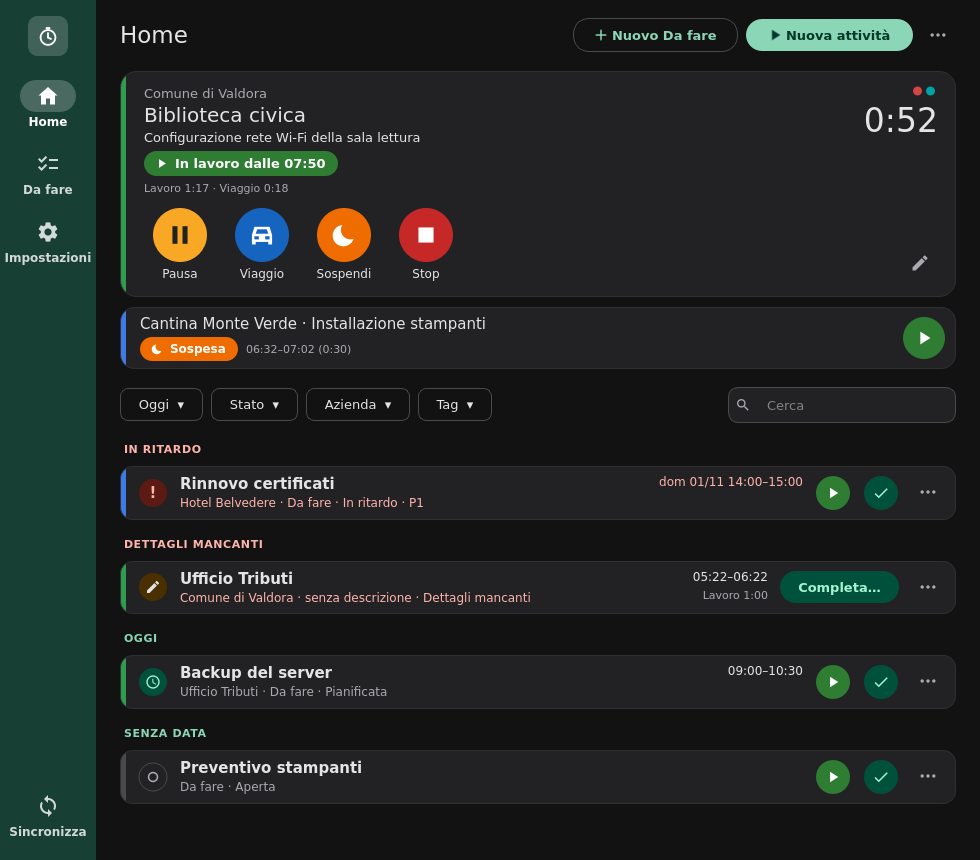

### Keyboard shortcuts

They work while the ActivityTrack window is active; the buttons' tooltips
recall them.

| Keys | What it does |
|---|---|
| **Ctrl+N** | New activity (quick entry) |
| **Ctrl+P** | Pause the activity at work or travelling; when none is, resume the paused one or the latest suspended |
| **Ctrl+T** | Stop the big card's activity; with details missing it opens "Completa l'attività" |
| **Ctrl+D** | New *To-do* |
| **Ctrl+F** | Search the list |
| **Ctrl+1**, **Ctrl+2**, **Ctrl+3** | Home, Da fare, Impostazioni |
| **F5** | Sync now |
| **Ctrl+Enter** | Confirm the open form |

With several activities at work together (when the policy allows it) Ctrl+P
asks which, in a small list: Enter picks the first, the latest.

Start, pause and stop also have shortcuts that work from any program:
§10.

## 6. Activities

### A new activity

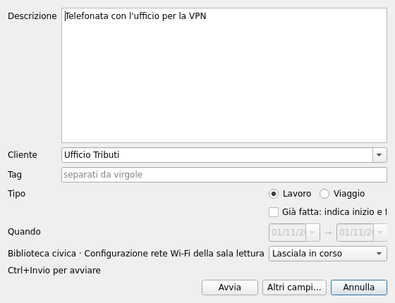

**"Nuova attività"** (from the menu, the Home or with **Ctrl+N**) opens the
quick entry, on top of the other windows:

- **Descrizione** (description), on several lines;
- **Cliente** (client): picked from the list or typed. A new name becomes a
  personal master record, when the policy allows it;
- **Tag**, separated by commas;
- **Lavoro** (work) or **Viaggio** (travel);
- **Adesso** (now) or **"Già fatta"** (already done): a finished activity,
  with start and end;
- the **activities running**: left running, suspended or stopped.

**Ctrl+Enter** starts it. **"Altri campi…"** (more fields) goes to the full
form with what was typed.

The full form opens from the Home's **⋯** menu too, **"Modulo completo…"**.

### The full form

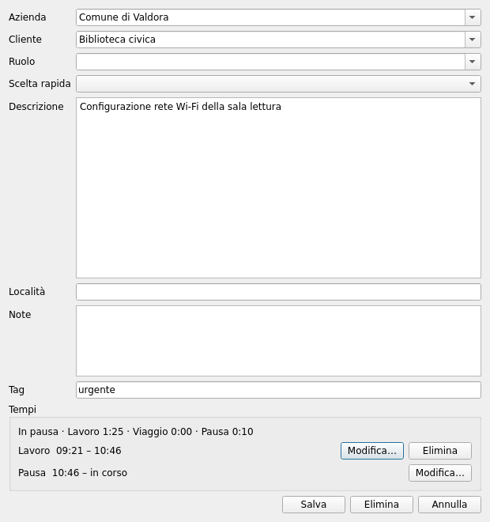

Company, client, role, quick pick, description, locality, notes and tags, as
the policy says (it may rename, hide or require them). For an existing
activity it also shows the **times**: each stretch (work, travel, pause) can
be changed or deleted, and a new one added, when the policy allows it. Two
overlapping stretches mark the activity **"da verificare"** (to check).

The **company** comes before the **client** and filters its list; a known
client chosen brings its company.

### Dates and times

Dates and times are typed in the format chosen in **Impostazioni → Generale**, or
picked: the calendar from the field's arrow and, for times, the app's
**5-minute grid** from the **▦** button next to the field. One row per hour,
12 hours at a time (**▲ Prima** / **Dopo ▼** move the window by 3 hours).
Start and end are chosen together: drag from the first cell to the last, or
click the first and then the last, and **OK**; at the top the range and its
length, the **hatched** cells are taken by other activities of that day.
**Orario esatto** (exact time) with **Usa** takes the minutes off the grid
(e.g. 09:37).

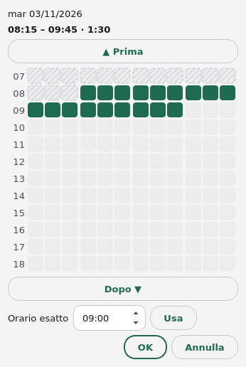

### Stop and completion

**Stop** (or **Ctrl+T**) closes the activity at once when it has client and description.
Otherwise, or when it comes from a *To-do*, it asks what is missing:

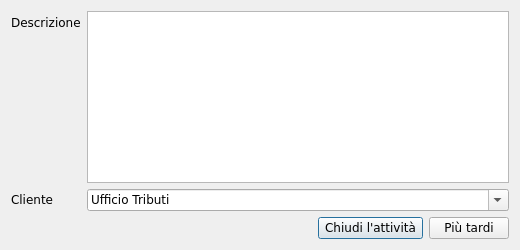

**"Chiudi l'attività"** (close it) completes it (without a description it
asks to confirm); **"Più tardi"** (later) leaves it among the **"Dettagli
mancanti"** (details missing) of the Home.

## 7. To-dos

Below the running activities the Home has one list, as the app: **In
ritardo** (overdue), **Dettagli mancanti**, **Oggi** (today), **Prossimi
giorni** (next days), **Giorni precedenti** (earlier days), **Senza data** (no
date), **Ignorate** (ignored). The filters **period** (Oggi, 24 h, 3 gg…),
**state** (to-dos, details missing, done, ignored), **company** and **tag**
are buttons with their menu, coloured when they are not the initial ones,
and are remembered; **Cerca** (search, Ctrl+F) narrows the list to the rows
with the words typed.

Each row has its state's mark on the left: **!** overdue, the clock when
planned, the circle when open, the pencil when details are missing, the
square when closed, the tick when done. A *To-do* has the round buttons
**Avvia** (start: an activity with its data) and **Fatto** (done) and, in the
**⋯** menu, **Posticipa** (postpone), **Ignora** (ignore) and **Modifica…**
(edit); a click on the row opens it. An activity with details missing has
**Completa…** (complete).

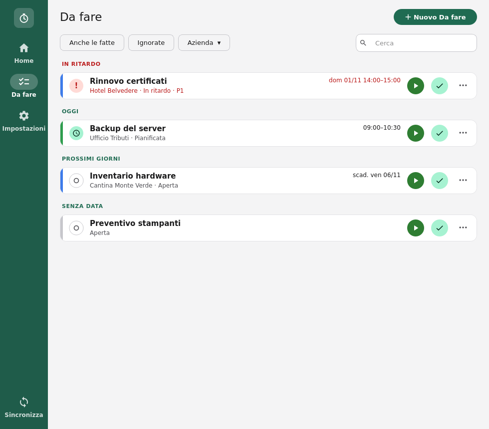

The **Da fare** section (Ctrl+2) shows them all, by due date and plan, with
**"Anche le fatte"** (done ones too), **Ignorate**, the company and the
search; **"Nuovo Da fare"** (or **Ctrl+D**) makes one.

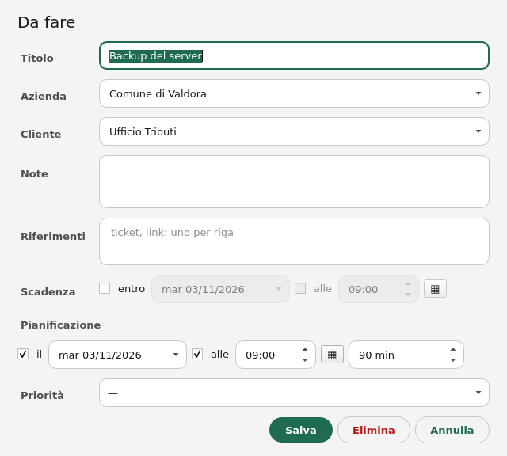

The form has title, company, client, notes, references (tickets, links: one
per line), **due date**, **plan** (day, time, duration) and **priority**. A
*To-do* from a management system is not deleted: it is ignored.

## 8. Reminders

The phone's, as desktop **notifications**:

- **"Ancora su …?"** (still on …?) while an activity runs: yes, pause, stop at
  the time of the last confirmation;
- **"Ancora in pausa?"** (still on pause?): resume, stop;
- **"Nessuna attività oggi"** (no activity today) after the working hours
  start: absent all day, start an activity;
- a **planned To-do** coming: start, postpone, re-plan;
- the **planned end** of an activity: yes, stop; no, go on.

On Linux the notifications have the buttons. On Windows, or where the
notifications have none, a click opens the question in a window:

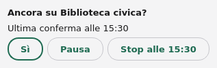

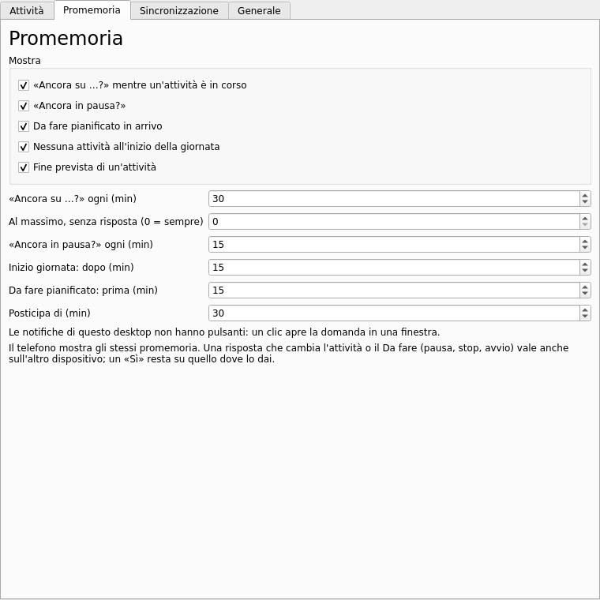

**Impostazioni → Promemoria** (reminders) switches each on or off and sets the
intervals; those the policy fixes are grey. The phone shows the same
reminders: an answer that changes the activity or the *To-do* also counts on
the other device.

## 9. General

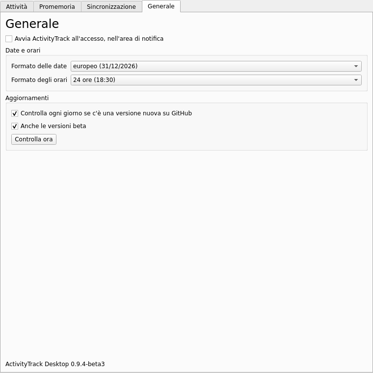

**Impostazioni → Generale** has:

- **"Avvia ActivityTrack all'accesso"** (start at sign-in): it starts with the
  session, hidden in the notification area. On Linux it is switched on at the
  first start; on Windows the installer offers it;
- **dates and times**: the date format, European (31/12/2026), American
  (12/31/2026) or ISO (2026-12-31), and the time format, 24 hours (18:30) or
  12 hours (6:30 PM). The command line and the terminal follow them too, as
  the preferences of ActivityTrack Web;
- **updates**: new versions are announced by the **server the PC is paired
  with**, at every sync; **"Controlla ora"** (check now) asks at once. The
  announcement is signed and accepted only if the signature is the server's,
  whose key comes in the pairing link: with an older link (no key) or another
  signature the program says so and offers nothing. A new version shows as a
  notification with **"Scarica"** (download): the package comes from the
  server, its SHA-256 is checked, and then it opens with the system's
  installer. If ActivityTrack was installed by the package manager (`apt`),
  the new version is reported but **not downloaded**: the package manager
  updates it. **"Anche le versioni beta"** (betas too) includes the test
  versions. The policy may fix both.

## 10. Global shortcuts

Three key combinations work from any program, even with ActivityTrack's
window closed:

| Keys | What they do |
|---|---|
| **Ctrl+Alt+A** | opens the new activity's window in front |
| **Ctrl+Alt+P** | pauses the activity at work or travelling (the most recent); when there is none, resumes the one on pause, else the latest suspended |
| **Ctrl+Alt+S** | stops the running activity; when details are missing it opens the sheet to complete it in front |

When more than one activity qualifies (concurrent activities), a small window
asks which. Pause, resume and stop are confirmed by a notification.

In **Generale** → **Scorciatoie globali** (global shortcuts) each one is
switched on or off and takes other keys (Ctrl, Alt or Super are needed, except
for the function keys); **"Ripristina predefinite"** (restore defaults) goes
back to the ones above. The line below says how they work on this desktop:

- **Windows**: directly;
- **Linux on X11** (XFCE, KDE or GNOME on X11): with the `python3-xlib`
  package, which the `.deb` package installs; with the `.tar.gz`, install it
  from the distribution;
- **Linux on Wayland** (KDE Plasma 6, GNOME 48 or later): through the
  desktop portal. The first time the desktop asks to confirm the keys; then
  they are changed in its settings (KDE: System Settings → Shortcuts; GNOME:
  Settings → Keyboard → Shortcuts). On Wayland the desktop may not bring the
  window in front of the others: it flashes in the task bar instead.

When a key is already taken by another program, the line says so. Where the
shortcuts are not available, or to use keys of your own, assign a desktop
shortcut to one of these commands:

```sh
activitytrack-desktop --start    # new activity
activitytrack-desktop --pause    # pause or resume
activitytrack-desktop --stop     # stop
```

The command goes to the ActivityTrack already open; when it is not open it
starts it in the notification area and runs the command. On Windows the
program is `ActivityTrack.exe` in the installation folder
(`%LOCALAPPDATA%\Programs\ActivityTrack`), with the same options.

## 11. The policy on the PC

The PC gets the phone's policy and applies the keys that concern it: features
(activities, travels, to-dos, planning, ignoring and deleting), fields (names,
required, hidden, read-only), editable times, free tags, activities only from
*To-dos*, central master data only, reminder intervals, updates. The
phone-only keys (location, calls, widgets…) do not concern it.

## 12. Common problems

| Problem | What to do |
|---|---|
| A shortcut does not work | Read the line under **Scorciatoie globali** in **Generale**: the key may be taken by another program, or `python3-xlib` may be missing (X11). Otherwise assign `activitytrack-desktop --pause` (or `--start`, `--stop`) to a key in the desktop's settings |
| The icon does not show | XFCE: add the notification area to the panel. GNOME: the AppIndicator extension is needed |
| Windows: "Windows protected your PC" | The program is not signed: "More info" → "Run anyway" |
| "Codice scaduto o già usato" (code expired or used) | The link is good for 10 minutes and once: make another on the web |
| "Il certificato del server non è valido" (certificate not valid) | The server has a self-signed certificate: use a link just made, which carries its key |
| "Il server ha revocato l'associazione" (pairing revoked) | Pair the PC again from the web: the data stay |
| "Il server non accetta più questa versione" (version no longer accepted) | Update ActivityTrack Desktop (Impostazioni → Generale, "Controlla ora") |
| "Va aggiornato il server" (the server must be updated) | Tell the ActivityTrack Web administrator |
| An activity made on the phone does not show | It comes within 30 seconds; **F5** ("Sincronizza") brings it at once |
