Versione 0.9.6 (novembre 2026). ActivityTrack Desktop è l'app per il PC
di ActivityTrack. Sta nell'area di notifica, vicino all'orologio, e tiene a un
clic le attività in corso e i *Da fare*. Così un'attività, anche breve, si
registra dalla tastiera, senza prendere il telefono.

## 1. Cosa serve

- Un server **ActivityTrack Web** dell'organizzazione: il PC si associa come
  un telefono e sincronizza nei due sensi.
- **Linux** con KDE Plasma o XFCE, su Wayland o X11, oppure **Windows 10 o 11**.

Senza rete il PC continua a lavorare: le modifiche partono quando la rete
torna. Report, anagrafiche e gestionali restano al telefono e al web.

Sul PC ActivityTrack è **un'applicazione sola**, con tre interfacce: questa
nell'area di notifica, la riga di comando (`activitytrack`, pacchetto
`activitytrack-cli`) e l'interfaccia a schermo intero nel terminale
(`activitytrack-tui`). Usano gli stessi dati (`~/.local/share/activitytrack`,
su Windows `%APPDATA%\activitytrack`) e la stessa associazione: quello che si
fa con una compare subito nelle altre. Tutte dipendono dalla libreria
`python3-activitytrack`.

## 2. Installazione

Dalla pagina delle release
(<https://gitlab.com/infraconsulting/activitytrack-desktop/-/releases>):

- **Debian 13 e 14, Ubuntu 24.04 e 26.04**: il pacchetto della propria
  distribuzione insieme a quello della libreria (dalla sua pagina,
  <https://gitlab.com/infraconsulting/python3-activitytrack/-/releases>), installati con
  `sudo apt install ./python3-activitytrack_<versione>-1-<distro>_all.deb ./activitytrack-desktop_<versione>-1-<distro>_all.deb`.
  ActivityTrack compare nel menu delle applicazioni.
- **Altre distribuzioni Linux**: servono Python 3.11 o più recente, PyQt6,
  cryptography e keyring dai pacchetti della distribuzione, e la libreria
  (`pip install` dal suo repository). Si scompatta
  `activitytrack-desktop-<versione>.tar.gz` e, nella sua cartella, si avvia
  `python3 -m activitytrack_desktop`.
- **Windows**: `ActivityTrackDesktop-<versione>-setup.exe`. Si installa per
  l'utente corrente, senza diritti di amministratore. Il programma **non è
  firmato** (non ha costi di certificati): al primo avvio Windows SmartScreen
  avvisa; si sceglie **"Ulteriori informazioni" → "Esegui comunque"**. Chi
  vuole controllare il file confronta il suo SHA-256 con `SHA256SUMS` della
  stessa release.

Su XFCE l'icona compare se il pannello ha l'**area di notifica** (plugin
"Status Tray" o "Notification Area"). GNOME senza l'estensione AppIndicator
non ha un'area di notifica: ActivityTrack resta allora aperto in una finestra.

## 3. Associazione al server

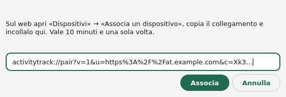

1. Sul web, apri **Dispositivi → "Associa un dispositivo"** (su ActivityTrack
   Web 0.9.3: **Telefoni → "Associa un telefono"**, il collegamento è sotto
   "Non riesci a inquadrarlo?").
2. Copia il **collegamento** che inizia con `activitytrack://pair`.
3. Al primo avvio ActivityTrack apre **Impostazioni → Sincronizzazione**:
   **"Associa a un server…"** (anche dalla Home) apre la finestra di
   associazione. Se il collegamento è già negli appunti lo trova da solo.
   Scegli **"Associa"**.

Il collegamento vale 10 minuti e una volta sola. Dopo l'associazione il PC
scarica i dati dell'utente e li tiene aggiornati.

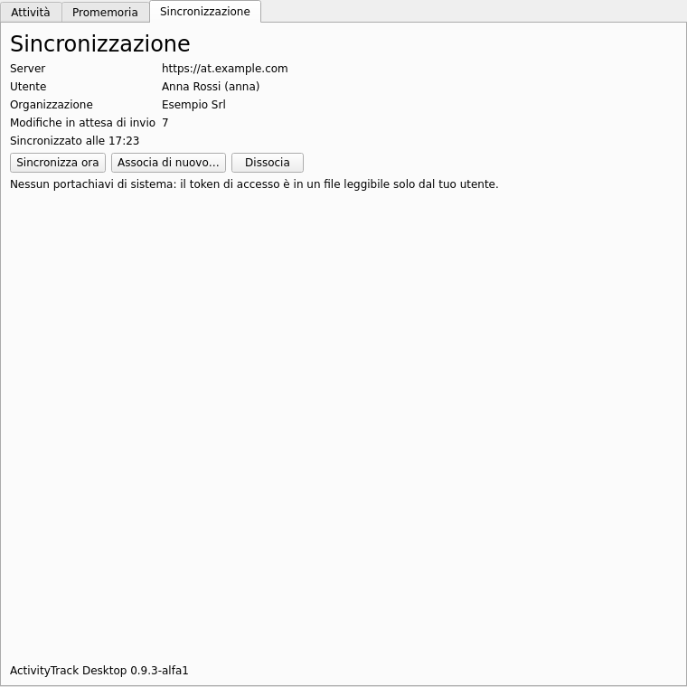

**Impostazioni → Sincronizzazione** mostra server, utente, organizzazione, le
modifiche in attesa e quelle rifiutate dal server (**"Non sincronizzati"**),
con **"Sincronizza ora"**, **"Associa di nuovo…"** e **"Dissocia"**. Dissociando
il PC tiene i suoi dati; associandolo a un altro server o utente li riparte
da zero.

Il token di accesso sta nel portachiavi del sistema (KWallet, GNOME Keyring,
Gestione credenziali di Windows). Senza portachiavi sta in un file leggibile
solo dal proprio utente, e la pagina lo dice.

## 4. L'icona e il menu

L'icona prende il colore dell'attività in corso: **verde** al lavoro,
**gialla** in pausa, **blu** in viaggio, grigia quando non c'è niente. Un
**punto rosso** dice che la sincronizzazione ha un problema (non associato,
associazione revocata, versioni incompatibili).

- **Passandoci sopra**: le attività in corso con il tempo trascorso.
- **Clic**: apre o chiude la finestra.
- **Clic centrale**: mette in pausa o riprende l'attività al lavoro.
- **Menu** (clic destro): per ogni attività in corso i suoi comandi
  (Pausa, Viaggio, Sospendi, Stop, Modifica…); **"Nuova attività…"**;
  **"Avvia Da fare ▸"** con quelli in ritardo e di oggi; **"Nuovo Da fare…"**;
  lo stato della sincronizzazione; **"Esci"**.

Chiudere la finestra la nasconde soltanto: ActivityTrack resta nell'area di
notifica fino a **"Esci"**.

## 5. La finestra

La finestra ha l'aspetto dell'app: a sinistra la barra verde con **Home**,
**Da fare** e **Impostazioni** (Ctrl+1, Ctrl+2, Ctrl+3) e, in basso,
**Sincronizza** (F5) con un punto rosso quando la sincronizzazione ha un
problema. È chiara o scura come il sistema.

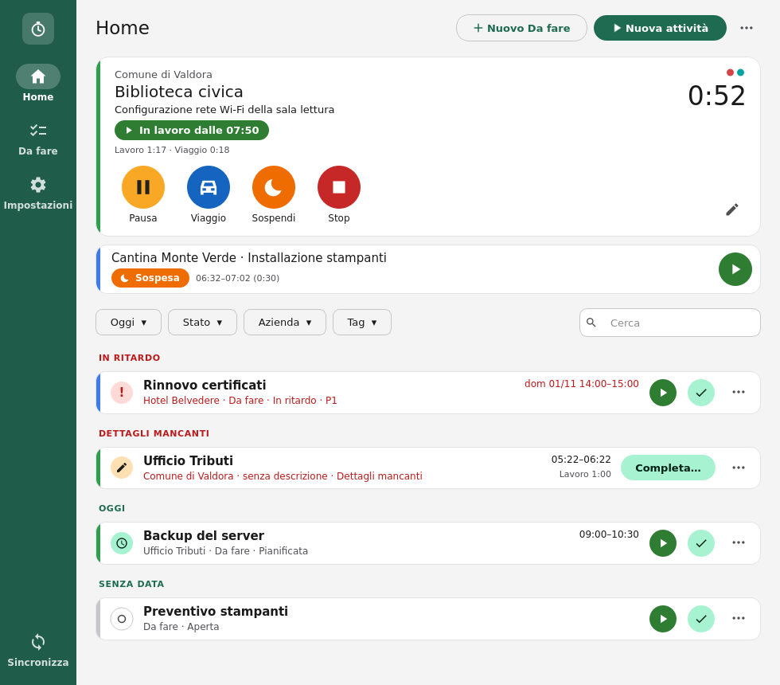

La **Home** è quella del telefono:

- in alto la **scheda grande** dell'ultima attività: azienda, cliente e
  descrizione, lo stato con l'ora (**"In lavoro dalle 07:46"**), i totali di
  lavoro e viaggio, a destra il tempo del tratto in corso e i colori dei tag.
  Sotto, i pulsanti tondi con il nome: **Pausa** o **Riprendi**, **Viaggio**,
  **Sospendi**, **Stop**. Un clic sulla scheda apre l'attività;
- sotto, le **schede piccole** delle altre attività in corso o sospese: una
  riga con lo stato e gli orari, e il pulsante tondo che la riprende o la
  mette in pausa. Un clic la porta nella scheda grande;
- quando non c'è niente in corso, la scheda grande ha **Avvia** e
  **Viaggio**;
- poi i filtri e la lista dei *Da fare* e delle attività chiuse (§7).

La striscia colorata a sinistra di ogni scheda è il colore dell'azienda (o
del cliente) scelto sul web o sul telefono.

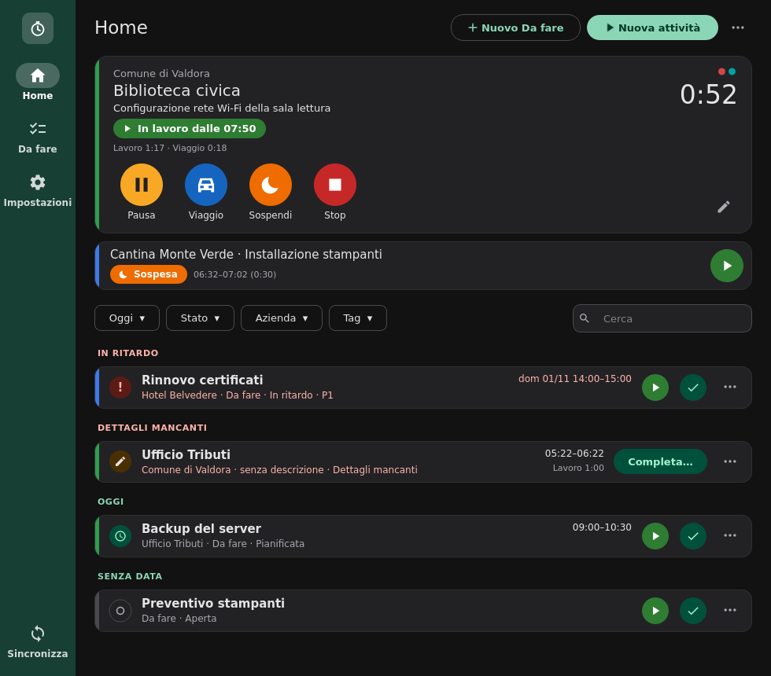

### Scorciatoie da tastiera

Valgono quando la finestra di ActivityTrack è attiva; i suggerimenti dei
pulsanti le ricordano.

| Tasti | Cosa fa |
|---|---|
| **Ctrl+N** | Nuova attività (inserimento rapido) |
| **Ctrl+P** | Pausa dell'attività al lavoro o in viaggio; se nessuna lo è, riprende quella in pausa o l'ultima sospesa |
| **Ctrl+T** | Stop dell'attività della scheda grande; se mancano i dettagli apre "Completa l'attività" |
| **Ctrl+D** | Nuovo *Da fare* |
| **Ctrl+F** | Cerca nella lista |
| **Ctrl+1**, **Ctrl+2**, **Ctrl+3** | Home, Da fare, Impostazioni |
| **F5** | Sincronizza ora |
| **Ctrl+Invio** | Conferma il modulo aperto |

Con più attività al lavoro insieme (quando la policy lo consente) Ctrl+P
chiede quale, in un piccolo elenco: Invio sceglie la prima, la più recente.

Avvio, pausa e stop hanno anche scorciatoie che funzionano da qualunque
programma: §10.

## 6. Le attività

### Nuova attività

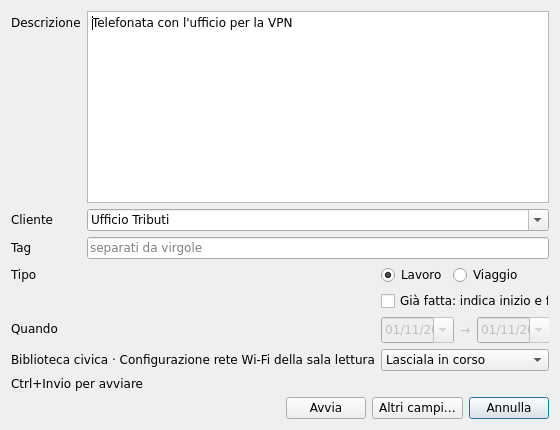

**"Nuova attività"** (dal menu, dalla Home o con **Ctrl+N**) apre
l'inserimento rapido, sopra le altre finestre:

- **Descrizione** su più righe;
- **Cliente**: si sceglie dall'elenco o si scrive. Un nome nuovo diventa
  un'anagrafica personale, se la policy lo consente;
- **Tag**, separati da virgole;
- **Lavoro** o **Viaggio**;
- **Adesso** o **"Già fatta"**: un'attività finita, con inizio e fine;
- le **attività in corso**: lasciarle in corso, sospenderle o fermarle.

**Ctrl+Invio** avvia. **"Altri campi…"** passa al modulo completo con quanto
già scritto.

Il modulo completo si apre anche dal menu **⋯** della Home, **"Modulo
completo…"**.

### Il modulo completo

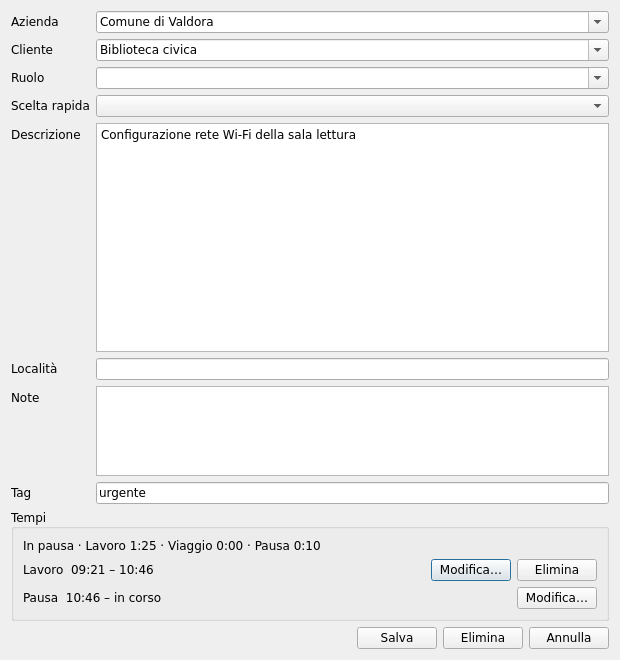

Azienda, cliente, ruolo, scelta rapida, descrizione, località, note e tag,
secondo la policy (che può rinominarli, nasconderli o renderli obbligatori).
Per un'attività esistente mostra anche i **tempi**: ogni tratto (lavoro,
viaggio, pausa) si può modificare o eliminare, e se ne aggiunge uno nuovo,
quando la policy lo permette. Due tratti sovrapposti segnano l'attività
**"da verificare"**.

L'**azienda** viene prima del **cliente** e ne filtra l'elenco; scegliendo un
cliente conosciuto, l'azienda diventa la sua.

### Date e orari

Date e orari si scrivono nel formato scelto in **Impostazioni → Generale**, oppure
si scelgono: il calendario dalla freccia del campo e, per gli orari, la
**griglia a 5 minuti** dell'app dal pulsante **▦** accanto al campo. Una riga
per ora, 12 ore alla volta (**▲ Prima** / **Dopo ▼** spostano la finestra di
3 ore). Inizio e fine si scelgono insieme: trascinando dalla prima casella
all'ultima, oppure cliccando la prima e poi l'ultima, e **OK**; in alto
l'intervallo e la durata, le caselle **tratteggiate** sono occupate da altre
attività di quel giorno. **Orario esatto** con **Usa** prende i minuti fuori
griglia (es. 09:37).

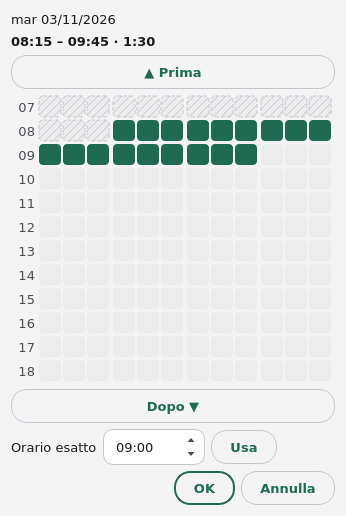

### Stop e completamento

**Stop** (o **Ctrl+T**) chiude subito l'attività se ha cliente e descrizione. Altrimenti, o
se viene da un *Da fare*, chiede quello che manca:

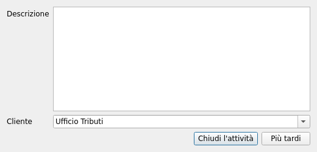

**"Chiudi l'attività"** la completa (senza descrizione chiede conferma);
**"Più tardi"** la lascia tra i **"Dettagli mancanti"** della Home.

## 7. I Da fare

Sotto le attività in corso la Home ha un'unica lista, come l'app: **In
ritardo**, **Dettagli mancanti**, **Oggi**, **Prossimi giorni**, **Giorni
precedenti**, **Senza data**, **Ignorate**. I filtri **periodo** (Oggi, 24 h,
3 gg…), **stato** (Da fare, Dettagli mancanti, Fatte, Ignorate), **azienda**
e **tag** sono pulsanti con il loro menu, colorati quando non sono quelli
iniziali, e restano memorizzati; **Cerca** (Ctrl+F) restringe la lista alle
righe che contengono le parole scritte.

Ogni riga ha a sinistra il segno del suo stato: **!** in ritardo,
l'orologio se pianificata, il cerchio se aperta, la matita se mancano i
dettagli, il quadrato se chiusa, la spunta se fatta. Un *Da fare* ha i
pulsanti tondi **Avvia** (un'attività con i suoi dati) e **Fatto** e, nel
menu **⋯**, **Posticipa**, **Ignora** e **Modifica…**; un clic sulla riga lo
apre. Un'attività con i dettagli mancanti ha **Completa…**.

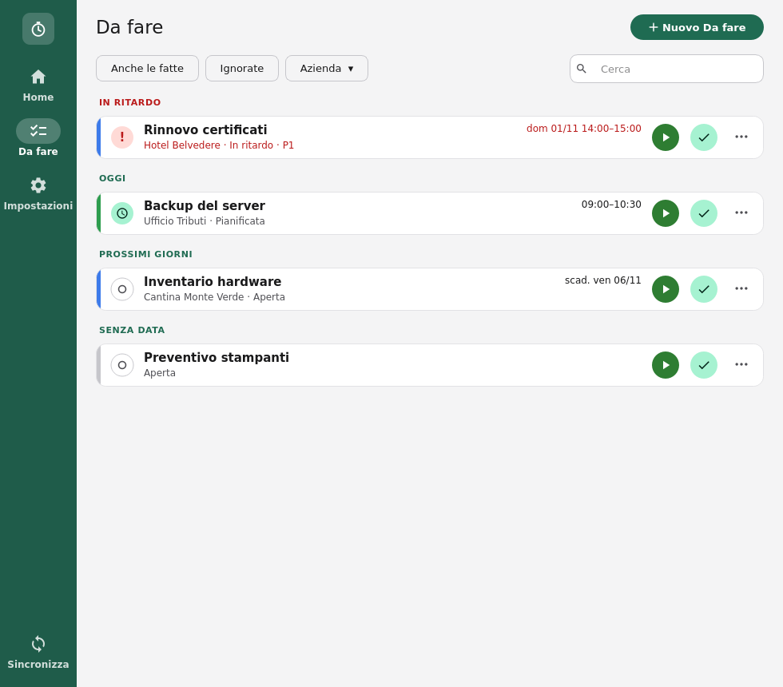

La sezione **Da fare** (Ctrl+2) li mostra tutti, per scadenza e
pianificazione, con **"Anche le fatte"**, **Ignorate**, l'azienda e la
ricerca; **"Nuovo Da fare"** (o **Ctrl+D**) ne crea uno.

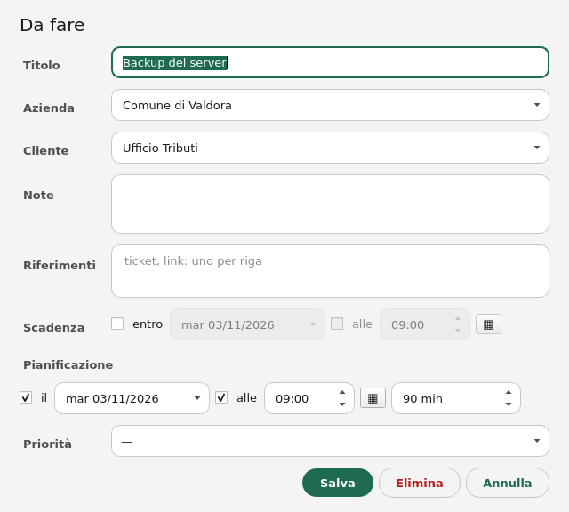

Il modulo ha titolo, azienda, cliente, note, riferimenti (ticket, link: uno
per riga), **scadenza**, **pianificazione** (giorno, ora, durata) e
**priorità**. Un *Da fare* del gestionale non si elimina: si ignora.

## 8. I promemoria

Gli stessi del telefono, come **notifiche** del desktop:

- **"Ancora su …?"** mentre un'attività è in corso: Sì, Pausa, Stop all'ora
  dell'ultima conferma;
- **"Ancora in pausa?"**: Riprendi, Stop;
- **"Nessuna attività oggi"** dopo l'inizio dell'orario di lavoro: Assente
  tutto il giorno, Avvia un'attività;
- un **Da fare pianificato** in arrivo: Avvia, Posticipa, Ripianifica;
- la **fine prevista** di un'attività: Sì, stop; No, continua.

Su Linux le notifiche hanno i pulsanti. Su Windows, o dove le notifiche non
li hanno, un clic apre la domanda in una finestra:

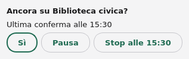

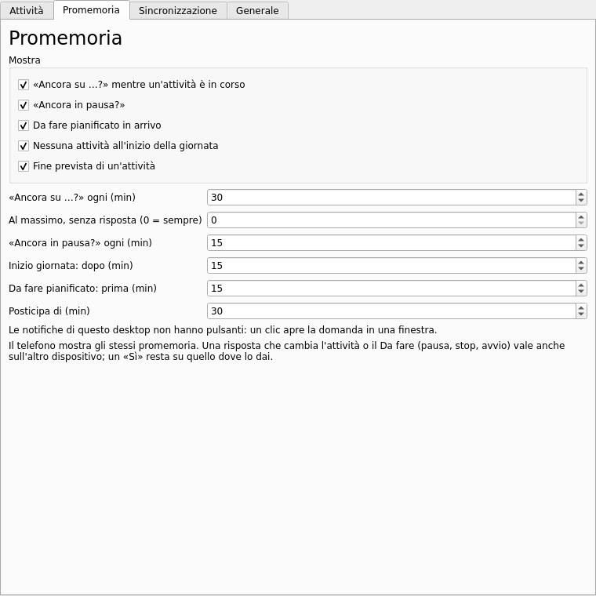

**Impostazioni → Promemoria** accende o spegne ciascuno e ne regola gli intervalli;
quelli fissati dalla policy sono grigi. Il telefono mostra gli stessi
promemoria: una risposta che cambia l'attività o il *Da fare* vale anche
sull'altro dispositivo.

## 9. Generale

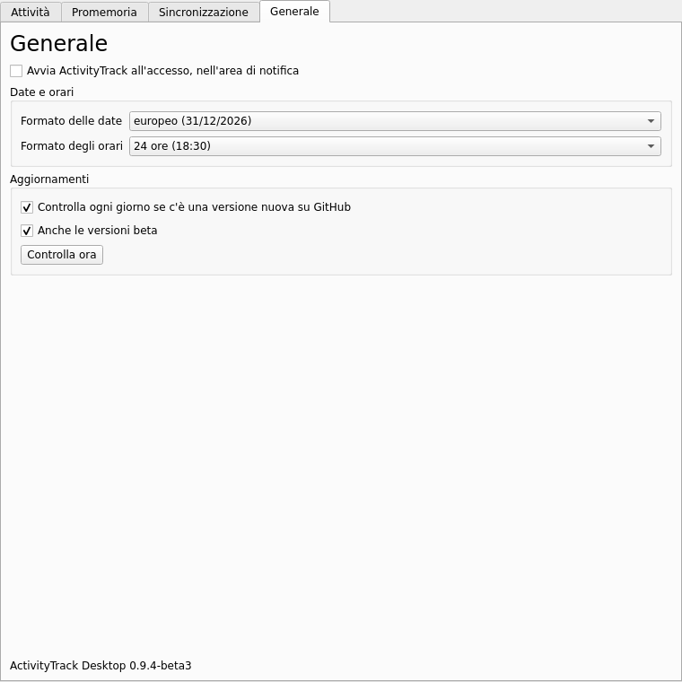

**Impostazioni → Generale** ha:

- **"Avvia ActivityTrack all'accesso"**: parte con la sessione, nascosto
  nell'area di notifica. Su Linux si accende al primo avvio; su Windows lo
  propone l'installazione;
- **date e orari**: il formato delle date, europeo (31/12/2026), americano
  (12/31/2026) o ISO (2026-12-31), e degli orari, 24 ore (18:30) o 12 ore
  (6:30 PM). Valgono anche per la riga di comando e il terminale, come le
  preferenze di ActivityTrack Web;
- **aggiornamenti**: una volta al giorno ActivityTrack controlla su GitLab se
  c'è una versione nuova, e la notifica con **"Scarica"**. **"Anche le
  versioni beta"** include le versioni di prova. La policy può fissare
  entrambe le scelte.

## 10. Scorciatoie globali

Tre combinazioni di tasti funzionano da qualunque programma, anche con la
finestra di ActivityTrack chiusa:

| Tasti | Cosa fanno |
|---|---|
| **Ctrl+Alt+A** | apre in primo piano la finestra della nuova attività |
| **Ctrl+Alt+P** | mette in pausa l'attività al lavoro o in viaggio (la più recente); se non ce n'è, riprende quella in pausa, altrimenti l'ultima sospesa |
| **Ctrl+Alt+S** | ferma l'attività in corso; se mancano i dettagli apre in primo piano la scheda per completarla |

Quando le attività candidate sono più d'una (attività contemporanee), una
piccola finestra chiede quale. Pausa, ripresa e stop si confermano con una
notifica.

In **Generale** → **Scorciatoie globali** ciascuna si accende o si spegne e
prende altri tasti (servono Ctrl, Alt o Super, tranne per i tasti funzione);
**"Ripristina predefinite"** torna a quelli sopra. La riga sotto dice come
funzionano su questo desktop:

- **Windows**: direttamente;
- **Linux su X11** (XFCE, KDE o GNOME su X11): con il pacchetto
  `python3-xlib`, che il pacchetto `.deb` installa; chi usa il `.tar.gz` lo
  installa dalla distribuzione;
- **Linux su Wayland** (KDE Plasma 6, GNOME 48 o successivi): attraverso il
  portale del desktop. La prima volta il desktop chiede di confermare i tasti;
  dopo si cambiano nelle sue impostazioni (KDE: Impostazioni di sistema →
  Scorciatoie; GNOME: Impostazioni → Tastiera → Scorciatoie). Su Wayland il
  desktop può non portare la finestra davanti alle altre: allora lampeggia
  nella barra delle applicazioni.

Se un tasto è già preso da un altro programma, la riga lo dice. Dove le
scorciatoie non sono disponibili, o per usare tasti propri, si assegna una
scorciatoia del desktop a uno di questi comandi:

```sh
activitytrack-desktop --start    # nuova attività
activitytrack-desktop --pause    # pausa o ripresa
activitytrack-desktop --stop     # stop
```

Il comando passa all'ActivityTrack già aperto; se non è aperto lo avvia
nell'area di notifica ed esegue il comando. Su Windows il programma è
`ActivityTrack.exe` nella cartella d'installazione
(`%LOCALAPPDATA%\Programs\ActivityTrack`), con le stesse opzioni.

## 11. La policy sul PC

Il PC riceve la stessa policy del telefono e applica le chiavi che lo
riguardano: funzioni (attività, viaggi, Da fare, pianificazione, ignorare ed
eliminare), campi (nomi, obbligatori, nascosti, sola lettura), tempi
modificabili, tag liberi, attività solo dai *Da fare*, anagrafiche solo
centrali, intervalli dei promemoria, aggiornamenti. Le chiavi solo del
telefono (posizione, chiamate, widget…) non lo riguardano.

## 12. Problemi comuni

| Problema | Cosa fare |
|---|---|
| Una scorciatoia non funziona | Leggi la riga sotto **Scorciatoie globali** in **Generale**: il tasto può essere preso da un altro programma, o mancare `python3-xlib` (X11). In alternativa assegna `activitytrack-desktop --pause` (o `--start`, `--stop`) a un tasto nelle impostazioni del desktop |
| L'icona non si vede | XFCE: aggiungi al pannello l'area di notifica. GNOME: serve l'estensione AppIndicator |
| Windows: "Windows ha protetto il PC" | Il programma non è firmato: "Ulteriori informazioni" → "Esegui comunque" |
| "Codice scaduto o già usato" | Il collegamento vale 10 minuti e una volta: creane un altro sul web |
| "Il certificato del server non è valido" | Il server ha un certificato autofirmato: usa il collegamento appena creato, che contiene la sua chiave |
| "Il server ha revocato l'associazione" | Associa di nuovo il PC dal web: i dati restano |
| "Il server non accetta più questa versione" | Aggiorna ActivityTrack Desktop (Impostazioni → Generale, "Controlla ora") |
| "Va aggiornato il server" | Avvisa l'amministratore di ActivityTrack Web |
| Un'attività fatta sul telefono non compare | Arriva entro 30 secondi; **F5** ("Sincronizza") la porta subito |
